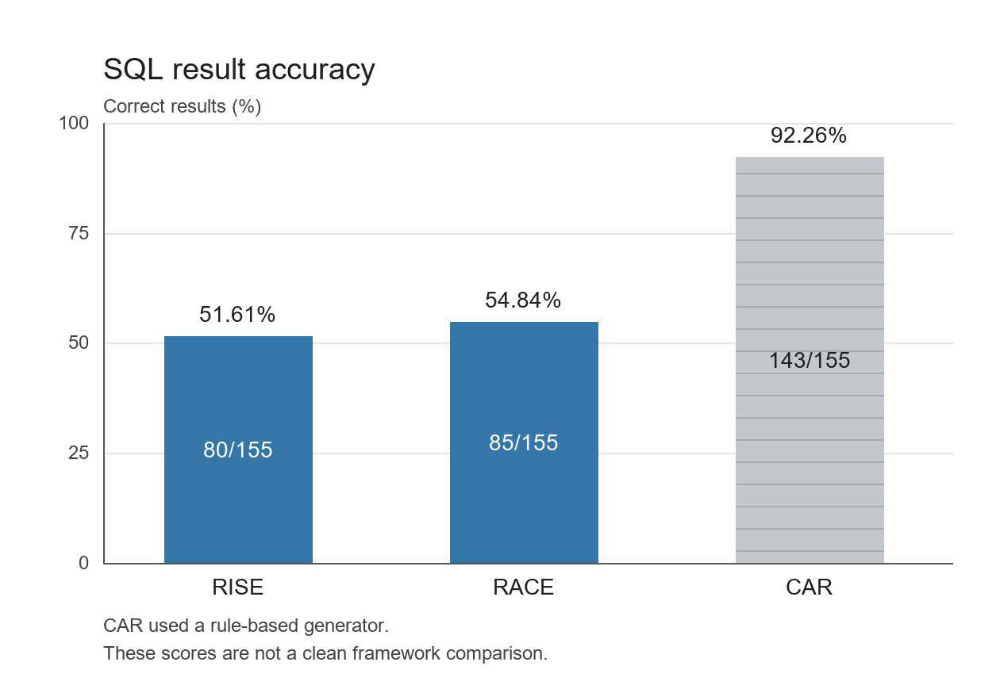

The runs used GitHub Copilot in VS Code. gpt-5.6-luna for all three runs. Each prompt was sent in a separate session.

RISE 80/155 51.61% 138.8 s
RACE 85/155 54.84% 130.6 s
CAR 143/155 92.26% 185.2 s

RACE was slightly better than RISE and finished faster. CAR had the highest score but took the longest.

The times include tool use and file operations, not just model inference. The CAR, RACE and RISE files below use the corresponding prompts in Task_1/CAR.txt, Task_1/RACE.txt and Task_1/RISE.txt. All used gpt-5.6-luna.

The CAR agent used a temporary PowerShell script with rules for generating SQL, despite the prompt. Therefore, its score does not show that CAR is the best framework.

data/restaurants_dataset_predictions_CAR.csv
data/restaurants_dataset_predictions_RACE.csv
data/restaurants_dataset_predictions_RISE.csv
