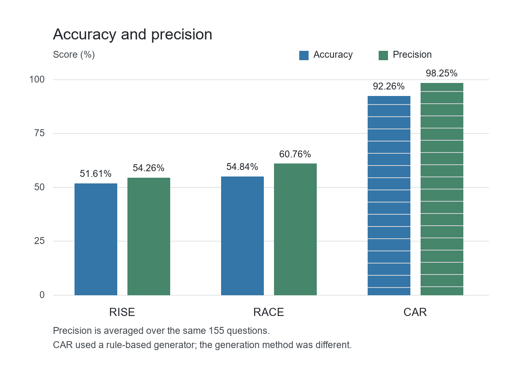
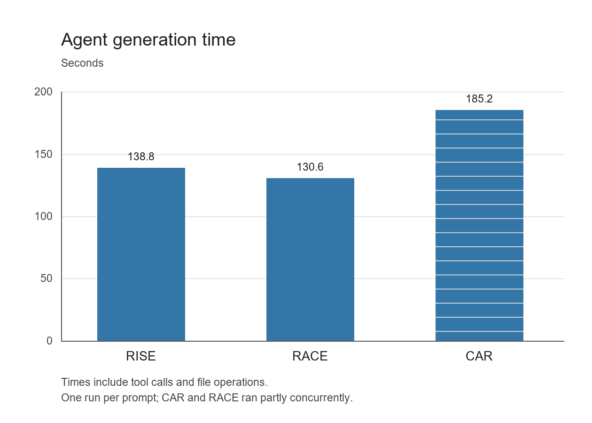

I compared the same questions using accuracy, precision and agent time. All runs used GitHub Copilot with gpt-5.6-luna in separate sessions. The SQL files were not changed.

| Prompt | Accuracy | Precision | Agent time |
| --- | ---: | ---: | ---: |
| RISE | 51.61% | 54.26% | 138.8 s |
| RACE | 54.84% | 60.76% | 130.6 s |
| CAR | 92.26% | 98.25% | 185.2 s |

I used a paired permutation test for both metrics, with Holm correction and a significance level of 0.05.

| Comparison | Accuracy p, adjusted | Precision p, adjusted | Significant on both metrics? |
| --- | ---: | ---: | --- |
| RACE - RISE | 0.6395 | 0.5348 | No |
| CAR - RISE | 0.000300 | 0.000300 | Yes |
| CAR - RACE | 0.000300 | 0.000300 | Yes |

RACE and RISE did not show a significant difference. CAR differed significantly on these saved results, but this does not prove that CAR is the best framework.

CAR uses a simple structure, RACE adds a role, and RISE separates input and scenario. The model was the same, but there was only one run per prompt, so variation between runs was not measured.

The agent also affected the comparison. CAR used a rule-based PowerShell generator despite the prompt. All three agents opened the CSV containing expected results. This shows answer exposure, not proof that those answers were used.

RACE was fastest and CAR was slowest. These times include tool use and file operations, not just model inference. CAR and RACE ran partly concurrently, so the timing comparison was not controlled.

Repeated question patterns also limit the statistical tests. More independent questions and repeated runs with the same generation method would give a fairer comparison.
