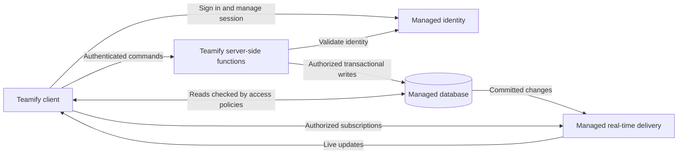

# ADR: Use a managed backend for Teamify's first version

Date: 2026-10-28  
Status: Proposed; architecture direction selected by the user; this ADR awaits user review and acceptance.  
Version: 1  
Provider: Open.

## Context

Teamify needs account and profile management, personal tasks and agendas, teams with member and administrator roles, shared events and invitations, polls, real-time group chat, and notifications with a saved history. Account deletion must remove personal data.

The user prioritizes simple development and quick delivery of the first version. Traffic estimates are unavailable, and independently scaling chat does not currently justify extra service complexity. The user has limited managed-backend experience but prefers less infrastructure work and is willing to learn a platform.

Workload, budget, client platform, availability targets and retention rules are unspecified. We assume an online client connected to a backend. Offline editing, mobile push delivery and specific performance guarantees are not established requirements.

## Decision and rationale

Use managed identity, a managed database and managed real-time delivery, with Teamify server-side functions for business commands. Leave provider selection open.

Clients authenticate through managed identity, send commands to Teamify functions and read or subscribe only to data allowed by Teamify access policies. Functions validate the caller and current ownership, membership or administrator role before changing data. Business modules remain within one application; Teamify will not initially operate an independent chat service.

This direction reduces the infrastructure Teamify must operate. It fits the user's expressed preference, accepting platform learning and provider coupling. Faster delivery is an expectation to validate, not a measured result or a claim that this is cheaper.

## Components, data and communication

Teamify logically owns profiles, teams and memberships, personal tasks, events and invitations, polls and votes, chat messages, and notification records in the managed database. The identity service owns credentials and session mechanisms; Teamify links identities to application records. Live delivery carries updates; the database remains the source for saved messages, notifications and reconnect recovery.

The diagram describes required capabilities rather than a verified provider topology. Selection must confirm supported transactions, access enforcement and subscription revocation.

## Alternatives considered

| Option | Benefits | Trade-offs and first-version assessment |
| --- | --- | --- |
| Modular monolith with a relational database | Centralized authorization and straightforward cross-feature transactions; direct backend control. | Teamify operates the backend and live delivery. Credible fallback, but the user prefers reducing infrastructure work. |
| Core application plus separate chat/live service | Independent deployments and scaling; some failure isolation. | Adds service communication, separate stores, coordinated deletion and eventual notification consistency. The user finds no current justification. |
| Managed backend (selected) | Provider operates supporting infrastructure; integrated identity and live delivery may reduce setup work. | Requires platform learning, careful policies and functions, and acceptance of provider-specific APIs and limits. Cost is unknown. |

## Responsibilities and consequences

The selected provider is expected to operate identity, database, function execution and real-time infrastructure under its service terms. Its actual capabilities, limits, recovery features and pricing must be checked during selection.

Teamify remains responsible for:

- Data modeling and business rules: invitations, administrator changes, voting, task/event completion and account lifecycle.
- Configuring and verifying access policies for personal and team data, and authorization inside privileged functions that may bypass ordinary policies.
- Durable messages and notification history, safe retries that avoid duplicate records, and reloading missed state after reconnecting.
- Revoking access when a user leaves a team, loses a role or deletes an account, including existing live subscriptions.
- Coordinating deletion across identity and application storage, including personal data in shared content; defining deletion behavior for backups and retained copies before implementation.
- Function and policy deployment, monitoring application failures, managing secrets, and validating recovery and data export procedures.

The main benefit is less infrastructure operation. The main disadvantages are learning effort, dependence on provider behavior, potentially costly usage patterns and migration work if the platform no longer fits. A managed platform does not remove application authorization or consistency work.

## Example: create a shared event

1. An authenticated administrator sends event details and a request identifier to a Teamify function.
2. The function verifies current membership and administrator authority at the write boundary.
3. One transaction stores the event, invitations and recipient notification records. The request identifier makes retries safe without duplicate creation. Provider selection must verify this transaction is supported for the chosen data model.
4. After commit, authorized subscriptions receive live changes. Clients reload persisted events and notifications after reconnecting; receiving a live update is not required for the event to exist.

A concrete implementation challenge is a member leaving while a subscription is open. Teamify must ensure current access is enforced for reads, commands and delivery, rather than trusting membership recorded at sign-in. The provider's revocation behavior must be verified before adopting that design; if it is insufficient, use a mediated delivery path or reconsider the provider.

## Open questions and revisit conditions

- Which provider supports the required transactions, function authorization, subscription revocation, coordinated deletion and usable data export?
- What are the budget, expected active users, chat volume, retention needs and availability targets? Use them to assess limits and costs when available.
- What are the rules for the last administrator, repeat votes, invitation eligibility and notification recipients? How should account deletion affect shared messages and other personal data?
- What delay and recovery behavior are acceptable for live updates? Is delivery beyond in-app subscriptions required?

Revisit the decision if platform constraints prevent required authorization, deletion or consistency; learning and configuration effort undermine delivery; measured usage makes limits or costs unsuitable; or independent chat scaling becomes a demonstrated need. A conventional modular backend remains an alternative if managed services do not fit.

## Sources and review

- [Teamify requirements](../data/Teamify.txt)
- [Discussion notes and user priorities](discussion-2026-10-28-354b6a64.md)

User review is pending. Review clarity, missing or unnecessary content, diagram connections and implementation responsibilities. Preserve this version when revising, record actual feedback in the discussion notes, and mark a subsequent version Accepted only after user acceptance.
